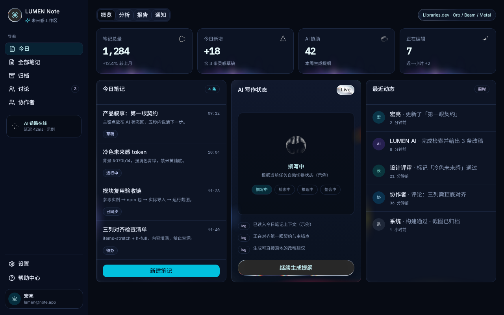
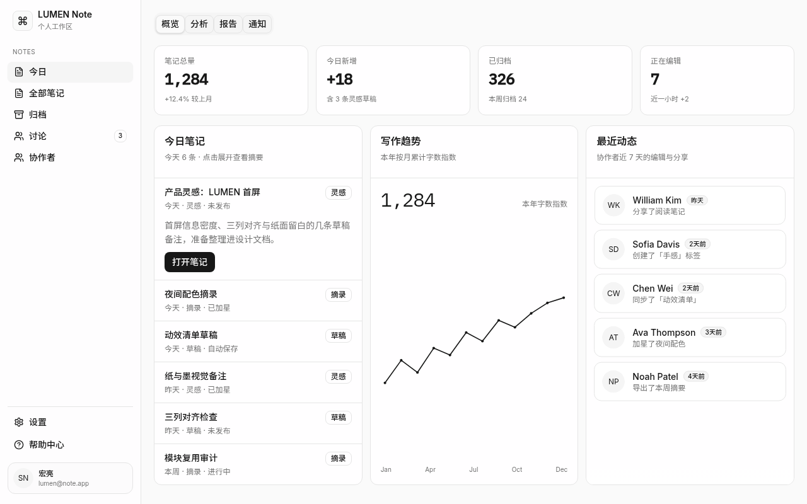
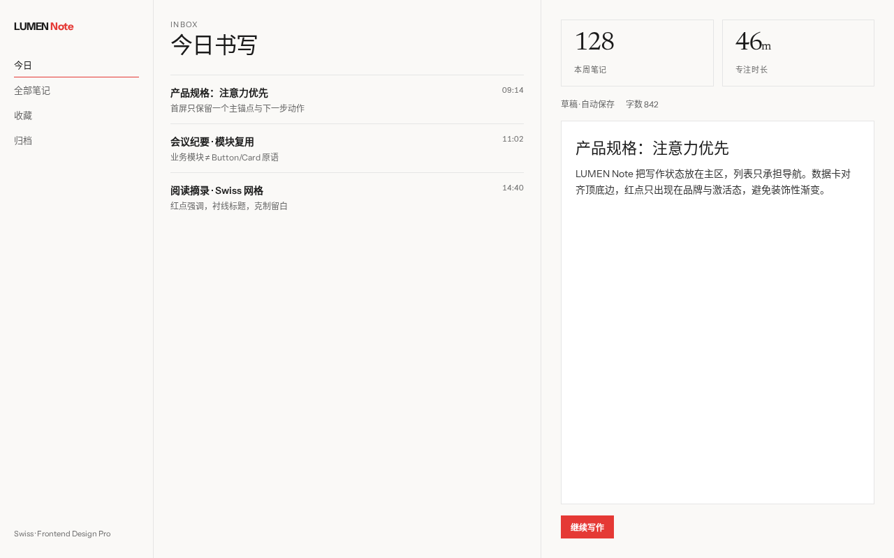
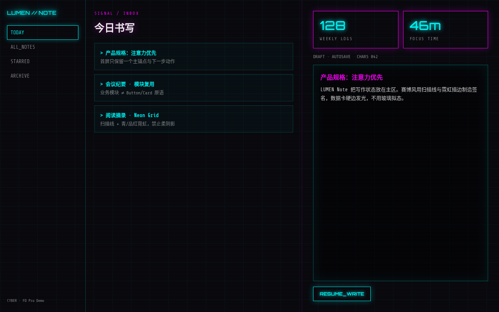
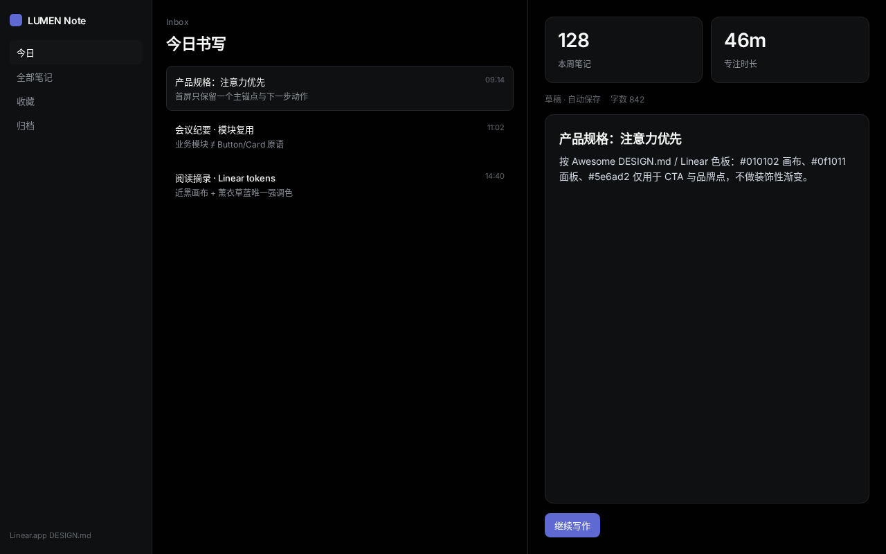
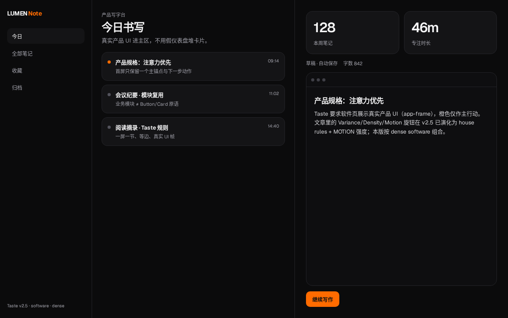
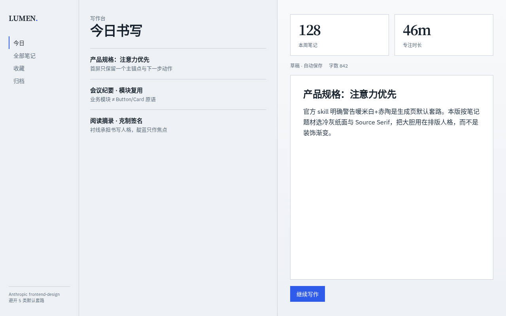
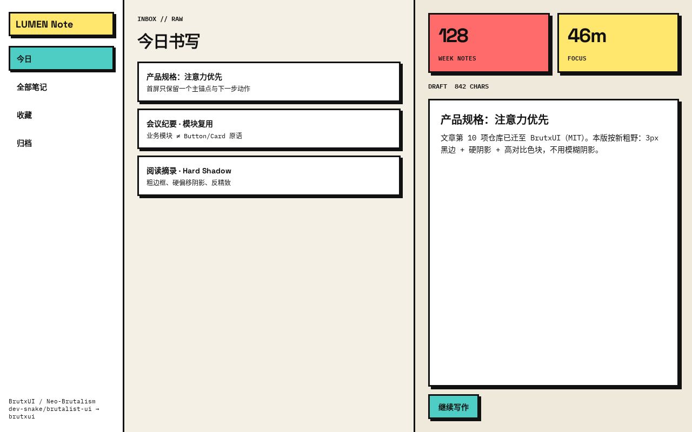

# Frontend Craft Skills

**把产品需求做成第一眼能看懂、敢点、能交出去的界面。**

不是风格皮肤包。仓库里是两套联动 Skill：`ai-ui`（视觉与规格）+ `app`（交互状态）。流程覆盖探索 → 规格 → 实现 → 多视口验收 → 模块复用证据 → unslop 去 AI 味。

<p align="center">
  <a href="ai-ui/SKILL.md"></a>
  <a href="app/SKILL.md"></a>
  <a href="docs/WORKFLOW_V4.md"></a>
  <a href="docs/CANDIDATE_RESOURCES.md"></a>
</p>

## Preview gallery

同一产品 **LUMEN Note**（侧栏 + 笔记列表 + 写作区 + 数据卡）。左上 / 右上是本仓库 `ai-ui` 产出；下面六张是用外部风格 Skill 的提示词做同构对照（只换美学，不走我们的模块复用与 QA 闭环）。

<table>
<tr>
<td align="center" width="50%">
<br>
<sub><b>ai-ui · future</b><br>Libraries.dev Orb / Beam / Metal + 业务壳</sub>
</td>
<td align="center" width="50%">
<br>
<sub><b>ai-ui · unslop</b><br>九层去 AI 味后的中性交付</sub>
</td>
</tr>
<tr>
<td align="center" width="33%">
<br>
<sub><b>对照 · Swiss</b></sub>
</td>
<td align="center" width="33%">
<br>
<sub><b>对照 · Cyberpunk</b></sub>
</td>
<td align="center" width="33%">
<br>
<sub><b>对照 · Linear tokens</b></sub>
</td>
</tr>
<tr>
<td align="center" width="33%">
<br>
<sub><b>对照 · Taste</b></sub>
</td>
<td align="center" width="33%">
<br>
<sub><b>对照 · Anthropic FD</b></sub>
</td>
<td align="center" width="33%">
<br>
<sub><b>对照 · Neo-Brutal</b></sub>
</td>
</tr>
</table>

<sub>截图归属见 [`docs/assets/previews/ATTRIBUTION.md`](docs/assets/previews/ATTRIBUTION.md)。对照图说明：风格 Skill 能换皮肤；本仓库要求的是可验收的业务模块与规格。</sub>

## Contents

- [Preview gallery](#preview-gallery)
- [和风格 Skill 差在哪](#和风格-skill-差在哪)
- [两套 Skill](#两套-skill)
- [硬规则](#硬规则)
- [三阶段工作流](#三阶段工作流)
- [安装](#安装)
- [校验](#校验)
- [仓库结构](#仓库结构)
- [资源目录](#资源目录)
- [样例](#样例)
- [许可证](#许可证)

## 和风格 Skill 差在哪

网上常见的 UI Skill（Frontend Design Pro、Taste、Awesome DESIGN.md、UI UX Pro Max 等）强在：美学方向、品牌 tokens、案例检索、反套路清单。

本仓库额外强制这些：

| 能力 | 本仓库 | 典型风格 Skill |
|------|--------|----------------|
| 探索多构图 + 锁定 visual signature | 有 | 有（风格表） |
| `design-spec` / first-impression 契约 | 有 | 少 |
| 交互 trigger → state → feedback → recovery | 有（`app`） | 少 |
| 业务模块复用证据链（MODULE_REUSE_MAP） | **有** | 通常无 |
| 布局对齐 / 图表撑满 / 禁零散留白 | **有** | 通常无 |
| 多视口真实截图 + 校验脚本 | 有 | 偶有 |
| unslop 九层诊断（不抹成灰白模板） | **有** | 部分有反 slop |

一句话：别人帮你「看起来像某个风格」；这里要求「像产品，并且说得出复用了哪块业务模块」。

## 两套 Skill

### [`ai-ui`](ai-ui/SKILL.md) · 视觉与规格

适用：新产品首屏、Dashboard、UI 还原、视觉优化。

- 按风格检索成熟业务模块并实证复用
- 编译 first-impression 契约与 `design-spec.json`
- 多视口验收后跑 unslop

### [`app`](app/SKILL.md) · 交互协议

适用：和 `ai-ui` 联动的可点界面。

- 把首屏与场景编成可测试的触发-状态-反馈-恢复
- 动效时间线、失败路径、可达性
- 与 design-spec 交叉校验 CTA 与组件 ID

详细流程：[`docs/WORKFLOW_V4.md`](docs/WORKFLOW_V4.md)。与 v3.3 差异：[`docs/ARCHITECTURE_CHANGES_V4.md`](docs/ARCHITECTURE_CHANGES_V4.md)。

## 硬规则

写进 `ai-ui/SKILL.md`，交付前必须过：

1. **先复用，禁止空白起手写整套 CSS / 动效。** 交付含复用清单（来源、许可、改了什么）。
2. **不能拿 Button/Card 冒充业务模块。** 开工先建 `MODULE_REUSE_MAP.md`；验收链：参考实例 → 源码与许可 → 真实导入 → 运行效果 → 截图。
3. **布局对齐。** 同行卡片顶边/底边对齐；图表填满卡片；禁止大片留白与参差。
4. **认可资源只记 URL。** 见 [`docs/APPROVED_RESOURCES.md`](docs/APPROVED_RESOURCES.md)；同类多个候选先问用户。
5. **QA 收尾必过 unslop。** 诊断无依据的渐变、字重、装饰、空洞文案、乱跳动画；不默认删彩色或动效。
6. **按风格选库，不固定套灰卡片。** 视频/文章推荐进候选，不自动算用户认可。

Agent 执行约定：[`AGENTS.md`](AGENTS.md)。

## 三阶段工作流

1. **Design Exploration** — 判断 persuade / operate / read / experience；出 2–3 条不同构图；锁定 visual signature。
2. **Specification Compilation** — first-impression 契约 + `design-spec.json` + `IMPLEMENTATION_SPEC.md`；与 `app` 的 interaction-spec 交叉校验。
3. **Implementation & Visual QA** — 复用实现 → 多视口截图 → 校验脚本 → 记缺陷并修 Top 问题 → unslop → 改前/改后图。

## 安装

完整包一起用（两个 Skill 要互相引用 spec）：

```text
your-skills-parent/
  ai-ui/
  app/
  docs/
  styles/
  examples/
  scripts/
```

把 `ai-ui/`、`app/` 拷进 Cursor / Claude Code 等客户端的 skills 目录，保留各自的 `references/` 与 `scripts/`。`docs/`、`styles/` 放在共享父级。按客户端要求微调 `SKILL.md` 里的相对路径。

更细的步骤：[`docs/INSTALL_V4.md`](docs/INSTALL_V4.md)。

示例用法：

```text
按 ai-ui 做 LUMEN Note 桌面 Dashboard 首屏。
先出 2 个构图方向，锁定 signature 后再写 design-spec。
实现必须有 MODULE_REUSE_MAP，QA 后跑 unslop。
```

## 校验

需要 Node 18+，不依赖额外 npm 包：

```bash
node ai-ui/scripts/validate-spec.mjs examples/attention-contract/design-spec.json
node app/scripts/validate-interaction.mjs \
  examples/attention-contract/interaction-spec.json \
  examples/attention-contract/design-spec.json
node ai-ui/scripts/validate-first-impression.mjs \
  examples/attention-contract/design-spec.json \
  examples/attention-contract/interaction-spec.json
node scripts/test-v4.mjs
```

自动校验通过 ≠ 审美通过。还要以真实浏览器截图验收。

## 仓库结构

```text
frontend-craft-skills/
├── ai-ui/                 # 视觉 Skill + references + 校验脚本
├── app/                   # 交互 Skill + 状态契约
├── docs/                  # 工作流、资源目录、预览图
│   ├── APPROVED_RESOURCES.md
│   ├── CANDIDATE_RESOURCES.md
│   ├── WORKFLOW_V4.md
│   └── assets/previews/   # README 预览截图
├── examples/              # attention-contract 等可打开演示
├── styles/                # 保留的 CSS 配方
├── scripts/               # 整包测试
├── AGENTS.md
└── README.md
```

`legacy/` 是旧实验素材，默认不要当生产依赖。

## 资源目录

| 文件 | 用途 |
|------|------|
| [`docs/APPROVED_RESOURCES.md`](docs/APPROVED_RESOURCES.md) | 用户明确认可的组件/动效/设计库，只记 URL |
| [`docs/CANDIDATE_RESOURCES.md`](docs/CANDIDATE_RESOURCES.md) | 已核实官网与许可边界的候选（如 BoardUI、Libraries.dev） |
| [`docs/LIBRARY_SELECTION.md`](docs/LIBRARY_SELECTION.md) | 选型原则 |

付费 Pro 组件未获授权不下载、不仿冒实现；可用公开预览比较。

## 样例

[`examples/attention-contract/`](examples/attention-contract/) 是不依赖安装的概念演示（模拟数据）。**不是真实业务产品**，也不宣称转化率提升。

LUMEN 对比预览图只用于说明本 Skill 与「纯风格包」的差别，见上方 Gallery。

## 许可证

本仓库用于公开管理两套前端 Skill 与文档。第三方组件、设计库、截图中的品牌与其原始许可归权利人所有；使用前核对各来源 LICENSE。新增示例与规范文档为仓库原创内容。

相关阅读：[`docs/CHANGELOG.md`](docs/CHANGELOG.md) · [`docs/VALIDATION_REPORT_V4.md`](docs/VALIDATION_REPORT_V4.md) · [`docs/GITHUB_PUBLISH.md`](docs/GITHUB_PUBLISH.md)
